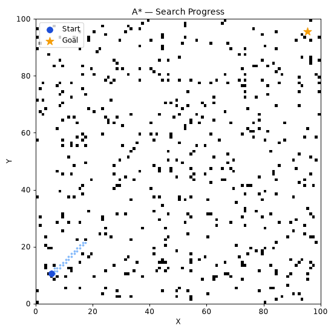
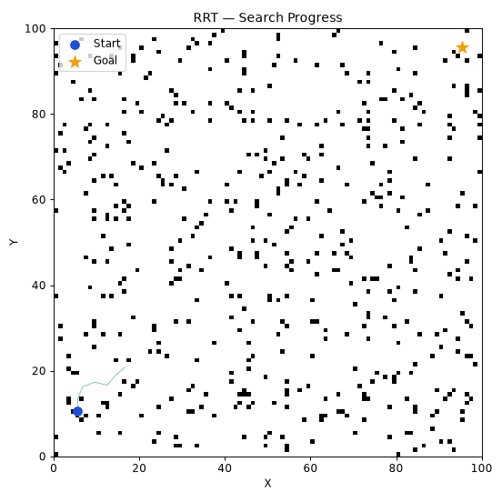
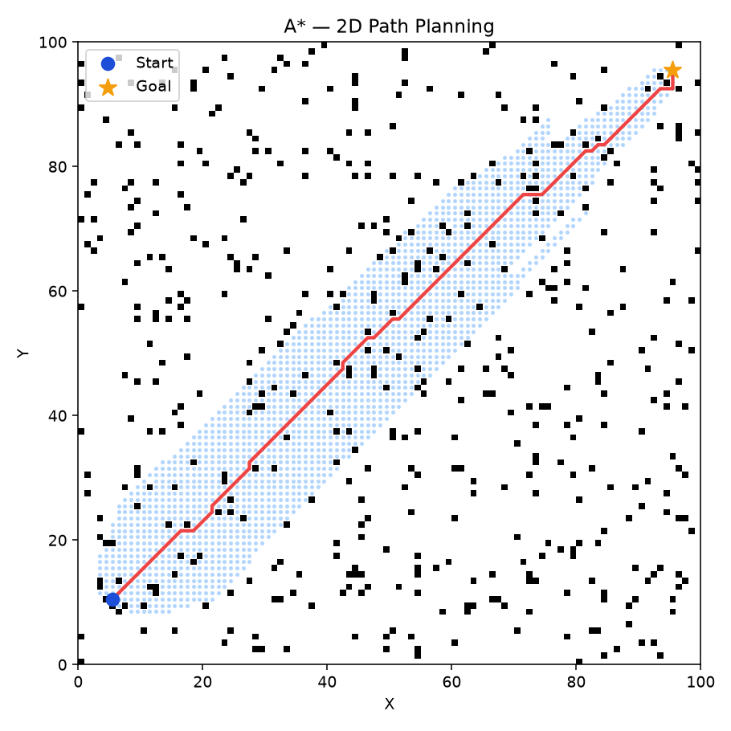
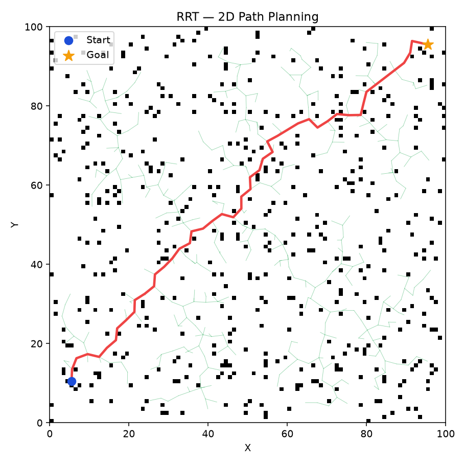

# 2D Robot Path Planning: A* vs. RRT

A Python implementation and experimental comparison of **A** (A-star search) and **RRT** (Rapidly-exploring Random Tree) for collision-free path planning in static 2D occupancy-grid environments.

The project includes reproducible map generation, collision checking, search visualization, animated demonstrations, automated benchmarks, and unit tests.

## Demonstrations

| A* Search | RRT Exploration |
|:---:|:---:|
|  |  |

### Example planned paths

| A* | RRT |
|:---:|:---:|
|  |  |

## Algorithms

**A*** performs heuristic-guided graph search on the occupancy grid, using Euclidean distance as the heuristic and eight-connected grid movements.

**RRT** incrementally explores the free space by sampling configurations, extending a tree, and checking candidate edges for collisions. Its randomized search can produce different paths across runs.

Both planners operate on the same static grid representation, but their exploration strategies differ. This project compares them empirically rather than claiming that one planner is universally superior.

## Features

- Reproducible 2D occupancy-grid generation with configurable obstacle-placement attempts and random seeds
- A* and RRT implementations in separate Python modules
- Point and segment collision checking
- Search-history visualization and GIF export
- Command-line demos and repeated benchmark runs
- CSV output containing success, execution time, path length, and exploration counts
- A Jupyter notebook for experimentation and automated tests for core behavior

## Project Structure

```text
2D-Robot-Path-Planning/
├── assets/                    # A* and RRT animated GIFs
├── notebooks/
│   └── Experiment.ipynb       # Interactive experiments
├── results/
│   ├── astar_path.png
│   ├── rrt_path.png
│   └── benchmark.csv
├── src/path_planning/
│   ├── astar.py                # A* planner
│   ├── rrt.py                  # RRT planner
│   ├── maps.py                # Occupancy-grid generation
│   ├── collision.py           # Collision checking
│   ├── metrics.py             # Performance metrics
│   ├── benchmark.py           # Repeated comparisons
│   ├── visualization.py       # Plots and animations
│   └── cli.py                 # Command-line interface
├── tests/                     # Planner and collision tests
├── pyproject.toml
├── requirements.txt
└── README.md
```

## Installation

Requires **Python 3.10+**.

```bash
git clone https://github.com/YOUR_USERNAME/2D-Robot-Path-Planning.git
cd 2D-Robot-Path-Planning
python -m venv .venv
```

Activate the environment:

```bash
# macOS / Linux
source .venv/bin/activate

# Windows PowerShell
.venv\Scripts\Activate.ps1
```

Install the project and test dependencies:

```bash
python -m pip install -e ".[dev]"
```

> Replace `YOUR_USERNAME` with your GitHub username, or download the repository as a ZIP and install from its extracted directory.

## Usage

### Run a demo

```bash
path-planning demo
```

This runs both planners on the same generated map and saves:

- `results/astar_path.png`
- `results/rrt_path.png`

Change the obstacle-placement attempts, map seed, or RRT iteration budget:

```bash
path-planning demo --obstacles 500 --seed 42 --rrt-iterations 5000
```

Export animations:

```bash
path-planning demo --gif
```

GIFs are written to `assets/astar_demo.gif` and `assets/rrt_demo.gif`.

### Run benchmarks

```bash
path-planning benchmark --runs 20 --rrt-iterations 5000
```

The benchmark uses three obstacle-placement settings (`100`, `500`, and `1000`) and runs each algorithm 20 times per setting. Both algorithms receive the **same generated map** for each paired run. Results are saved to `results/benchmark.csv` and a summary is printed in the terminal.

### Run tests

```bash
python -m pytest -q
```

## Benchmark Methodology

The stored experiment contains **120 algorithm runs**: 2 planners × 3 obstacle settings × 20 runs. The default map size is 100 × 100 cells, with start `(5, 10)` and goal `(95, 95)`.

The reported metrics are:

| Metric | Definition | Preferred direction |
|---|---|---|
| Success rate | Percentage of runs returning a path | Higher |
| Execution time | Mean planning runtime measured in milliseconds | Lower |
| Path length | Sum of Euclidean distances along the returned path, for successful runs | Lower |
| Exploration count | Number of entries in the algorithm's recorded search history | Context-dependent |

**Important:** The obstacle parameter specifies *random placement attempts*, not necessarily the number of unique occupied cells. Search-history counts do not necessarily represent identical operations for A* and RRT, so they should not be treated as directly comparable computational effort.

### Results from the committed CSV

| Obstacle attempts | Planner | Success rate | Mean time (ms) | Mean path length |
|---:|:---:|---:|---:|---:|
| 100 | A* | 100% | 34.39 | 125.56 |
| 100 | RRT | 100% | 7.48 | 144.88 |
| 500 | A* | 100% | 64.89 | 128.11 |
| 500 | RRT | 100% | 56.53 | 150.80 |
| 1000 | A* | 100% | 109.17 | 131.80 |
| 1000 | RRT | 100% | 147.46 | 155.89 |

In these saved experiments, A* produced shorter paths at all three obstacle settings. RRT was faster at the two lower settings, whereas A* was faster at the highest setting. All runs returned paths in this particular benchmark; the results do **not** establish universal success or performance guarantees.
